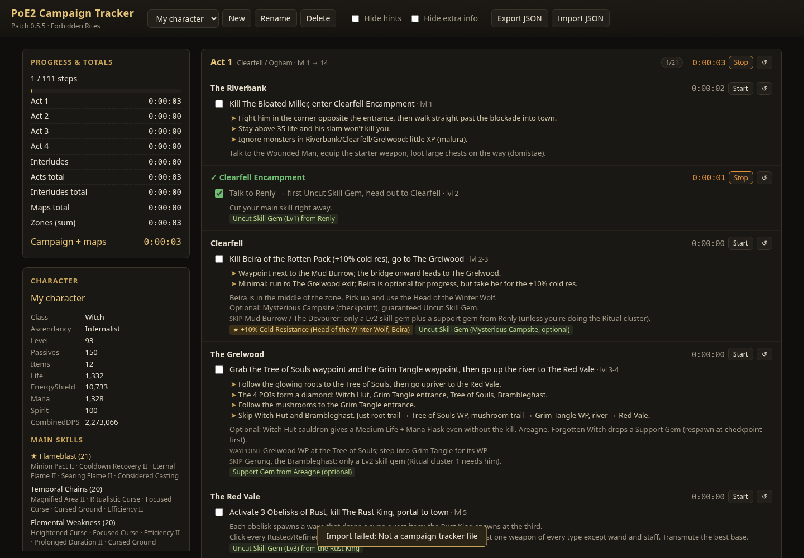

# PoE2 Campaign Tracker

A static, offline-friendly web app for tracking a **Path of Exile 2** campaign run
(Acts 1–4 + Interludes, patch 0.5.5 / Forbidden Rites route data), with timers,
per-character saves and optional Path of Building 2 import.



## Features

- **Route checklist**: 111 steps grouped by act/interlude → zone, with objective, level,
  hints (layout / speed tips) and extra info (details, waypoints, skips, rewards, warnings).
- **Toggles**: *Hide hints* and *Hide extra info* (persisted).
- **Timers**: start/stop/reset per zone, per act, per interlude and per endgame map;
  totals for acts, interludes, maps, the sum of zones and a grand total. Starting a zone
  timer stops other zone timers and starts its act/interlude timer. Timers store a start
  timestamp, so they stay correct across reloads and background tabs.
- **Characters**: one saved campaign per character; create, switch, rename, delete.
- **Persistence**: everything is saved in `localStorage` (`poe2-campaign-tracker:v1`).
- **Export / import** JSON. Import merges characters (same id overwrites) and rejects invalid files.
- **PoB2 import** (optional): paste an export code; it is decoded in the browser
  (base64url → zlib inflate via `DecompressionStream` → XML) and shows class, ascendancy,
  level, passives, item count, key stats and main skills with supports. Invalid codes show
  a clear error and do not change the saved state. Links (pobb.in etc.) are not fetched;
  paste the raw code.

## Run

No build step is needed. Open `index.html` directly, or serve it:

```sh
python3 -m http.server 8765 --bind 127.0.0.1
# → http://127.0.0.1:8765/
```

## Project layout

```
index.html            markup + script includes (plain scripts, works from file://)
css/styles.css        theme and layout
js/storage.js         state shape, localStorage, JSON export/import
js/timers.js          stopwatch helpers
js/pob.js             PoB2 code decoder + summariser
js/app.js             rendering and event handling
data/campaign.js      generated route data (do not edit)
scripts/build_data.py regenerates data/campaign.js from route.json
tests/smoke_test.py   Playwright headless smoke test (also writes the screenshot)
```

## Updating route data

The route is taken from the earlier single-file guide (`/workspace/poe2/campaign/route.json`):

```sh
python3 scripts/build_data.py /path/to/route.json
```

## Tests

```sh
pip install playwright && python3 -m playwright install chromium
python3 -m http.server 8765 --bind 127.0.0.1 &
python3 tests/smoke_test.py
```

## Disclaimer

Fan-made project, not affiliated with or endorsed by Grinding Gear Games. Route data is
compiled from community sources (malura's speedrun route, Domistae, Exile-UI, Maxroll,
poe2db) and may be outdated.
