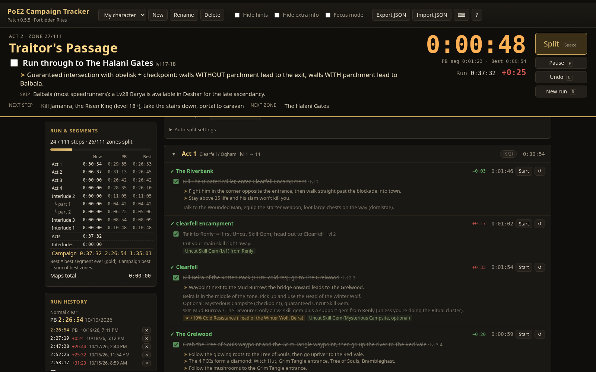
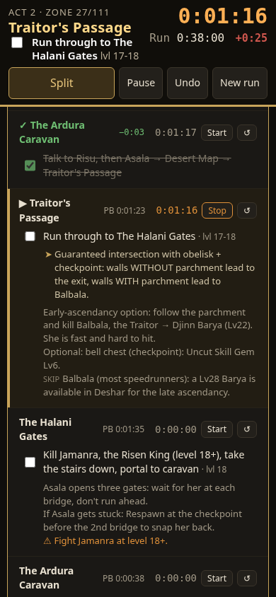

# PoE2 Campaign Tracker

A static, offline-friendly web app for tracking a **Path of Exile 2** campaign run
(Acts 1–4 + Interludes, patch 0.5.5 / Forbidden Rites route data), with timers,
per-character saves and optional Path of Building 2 import.



 

## Features

- **Route checklist**: 111 steps grouped by act/interlude → zone, with objective, level,
  hints (layout / speed tips) and extra info (details, waypoints, skips, rewards, warnings).
- **Toggles**: *Hide hints* and *Hide extra info* (persisted).
- **Speedrun splits**: every zone is a timed segment. A sticky "now" bar shows the current
  zone, its open steps, the zone timer, run time and live delta vs PB. `Space` starts the run
  and splits (completes the zone, starts the next one); ticking the last required step of the
  zone you are timing splits automatically. Undo, pause/resume and new run are one key each.
- **Separate interludes**: the route plays Interlude 2 (part 1) → Interlude 3 → Interlude 2
  (part 2) → Interlude 1. Each part is its own section; Interlude 1/2/3 each get a total
  (Interlude 2 = both parts). Act, interlude-part and interlude totals are sums of their zones.
- **History and PBs per character**: finished runs and reset attempts are saved with every zone,
  section and group time. PB = fastest complete run. Best segments (golds) are kept per zone,
  section and interlude; sum of best is shown. Each zone shows its delta vs the PB segment.
- **Manual timers**: start/stop/reset per zone (only one zone runs at a time) and per endgame map.
- **Focus mode** (`F`): show only the current act/interlude and hide completed zones,
  handy on a second monitor. The phone layout keeps a compact sticky bar with the split button.
- **Characters**: one saved campaign per character; create, switch, rename, delete.
- **Persistence**: everything is saved in `localStorage` (`poe2-campaign-tracker:v1`).
- **Export / import** JSON. Import merges characters (same id overwrites) and rejects invalid files.
- **PoB2 import** (optional): paste an export code; it is decoded in the browser
  (base64url → zlib inflate via `DecompressionStream` → XML) and shows class, ascendancy,
  level, passives, item count, key stats and main skills with supports. Invalid codes show
  a clear error and do not change the saved state. Links (pobb.in etc.) are not fetched;
  paste the raw code.

- **Big current-step bar**: zone name, current step (large), its hints and route info
  (rewards, waypoint, skips, warnings; following the hide toggles), the next step and the next zone,
  readable from a second monitor. The phone version only keeps zone, step, clock and buttons.
- **Route variants** (per character): *Normal clear* or *Fastest (speedrun)*. Both come from the
  original guide data: the fast route drops `skip_in_fast` steps and shows ⚡ speed tips. A *Required
  steps only* filter hides optional steps. Zones with no visible step drop out of the run. PB,
  best segments and history comparisons are kept per variant.
- **Auto-split from Client.txt** (off by default): see [Auto-split](#auto-split).
- **Rebindable hotkeys** (⌨ button): press a new key, conflicts are rejected, *Reset defaults*.
  Bindings are saved, included in JSON export/import and shown in the help overlay and on the buttons.
- **Run analytics**: campaign time per run (SVG chart with average and sum-of-best lines), a trend
  chart for any act, interlude, interlude part or zone, stat cards (runs, resets, PB, average,
  average of the last 5, sum of best, PB − SoB), a per-act table with avg − best (where you can
  gain the most), and **CSV export** (one row per run, every segment in seconds).
- **Map history**: each map row has *✓ Finish*, which saves the run and resets the timer. Per-map PB,
  average and run count (grouped by map name), a live delta vs that map's PB, recent runs, and a maps CSV.

## Keyboard shortcuts

Defaults (all can be changed in ⌨ settings):

| Key | Action |
| --- | --- |
| `Space` | Start run / split current zone |
| `U` | Undo last split |
| `P` | Pause / resume |
| `R` | New run (unfinished run saved as an attempt) |
| `C` | Scroll to current zone |
| `F` | Focus mode |
| `H` / `E` | Hide hints / hide extra info |
| `?` / `Esc` | Help; `Esc` also leaves a text field |

Browser hotkeys only work while the tracker window has focus. For keys that work while you are in the
game, use the helper's global hotkeys (below).

## Auto-split

Enable **Auto-split** on the route bar. The app then gets zone changes from the game's `Client.txt`:

- **Local helper (recommended)**: `helper/poe2_splitter.py` (Python standard library only) tails
  the log and serves Server-Sent Events on `http://127.0.0.1:8766/events` (localhost only, read-only).
  The pill shows *Helper: connected / not connected* and the app reconnects by itself.
- **No helper (Chrome/Edge)**: *Watch Client.txt…* uses the File System Access API to read the log
  from the tab. You must pick the file again after every reload, and the tab has to stay open.

Rules: entering the next route zone splits. If you missed some zones, entering one up to 4 zones
ahead closes the skipped ones with 0 time. Re-entering the current zone (death, portal, checkpoint),
hideouts, backtracking and off-route towns are ignored. Entering the first zone starts the run.
From the last zone, entering a map finishes it. Pause blocks auto-splits.

### Running the helper on Windows

1. Install Python 3 from python.org (tick *Add to PATH*), or `winget install Python.Python.3.12`.
2. Copy the `helper` folder to the gaming PC.
3. Double-click `run_helper.bat`, or in a terminal:
   ```bat
   py helper\poe2_splitter.py
   py helper\poe2_splitter.py --log "D:\SteamLibrary\steamapps\common\Path of Exile 2\logs\Client.txt"
   ```
   Default paths it looks for:
   - Steam: `C:\Program Files (x86)\Steam\steamapps\common\Path of Exile 2\logs\Client.txt`
   - Standalone: `C:\Program Files (x86)\Grinding Gear Games\Path of Exile 2\logs\Client.txt`
   - Other Steam library: pass `--log` or set `POE2_CLIENT_TXT`. In Steam, *Manage → Browse local files* opens the game folder.
4. Open the tracker in a browser on the same PC and tick **Auto-split**. If the helper runs elsewhere, change the URL in *Auto-split settings*.
5. Optional global hotkeys (they work while the game has focus): `py -m pip install pynput`, then
   `py helper\poe2_splitter.py --hotkeys` (F1 split, F2 undo, F3 pause), or for example `--hotkeys split=f5,undo=f6,pause=f7`.

Other options: `--port 8766` and `--from-start` (replay the whole log, for testing).

## Run

No build step is needed. Open `index.html` directly, or serve it:

```sh
python3 -m http.server 8765 --bind 127.0.0.1
# → http://127.0.0.1:8765/
```

## Project layout

```
index.html            markup + script includes (plain scripts, works from file://)
css/styles.css        theme and layout
js/storage.js         state shape, localStorage, JSON export/import
js/timers.js          stopwatch helpers
js/charts.js          tiny SVG line chart
js/autosplit.js       Client.txt zone matching, helper (SSE) + File System Access sources
helper/               poe2_splitter.py (Client.txt → SSE), run_helper.bat, parser unit tests
js/run.js             speedrun logic: current zone, split/undo/pause, history, PB, bests
js/pob.js             PoB2 code decoder + summariser
js/app.js             rendering and event handling
data/campaign.js      generated route data (do not edit)
scripts/build_data.py regenerates data/campaign.js from route.json
tests/smoke_test.py   Playwright end-to-end test (fake clock; writes screenshots/milestone2.png)
```

## Updating route data

The route is taken from the earlier single-file guide (`/workspace/poe2/campaign/route.json`):

```sh
python3 scripts/build_data.py /path/to/route.json
```

## Tests

```sh
pip install playwright && python3 -m playwright install chromium
python3 -m http.server 8765 --bind 127.0.0.1 &
python3 tests/smoke_test.py       # main end-to-end test (fake clock)
python3 tests/autosplit_test.py   # real helper + fake Client.txt appends
python3 helper/test_helper.py     # parser unit tests
python3 tests/screenshots.py      # regenerate screenshots/milestone3*.png
```

## Disclaimer

Fan-made project, not affiliated with or endorsed by Grinding Gear Games. Route data is
compiled from community sources (malura's speedrun route, Domistae, Exile-UI, Maxroll,
poe2db) and may be outdated.
