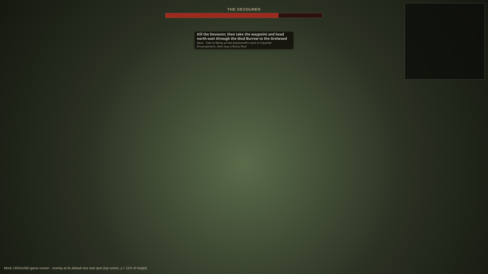
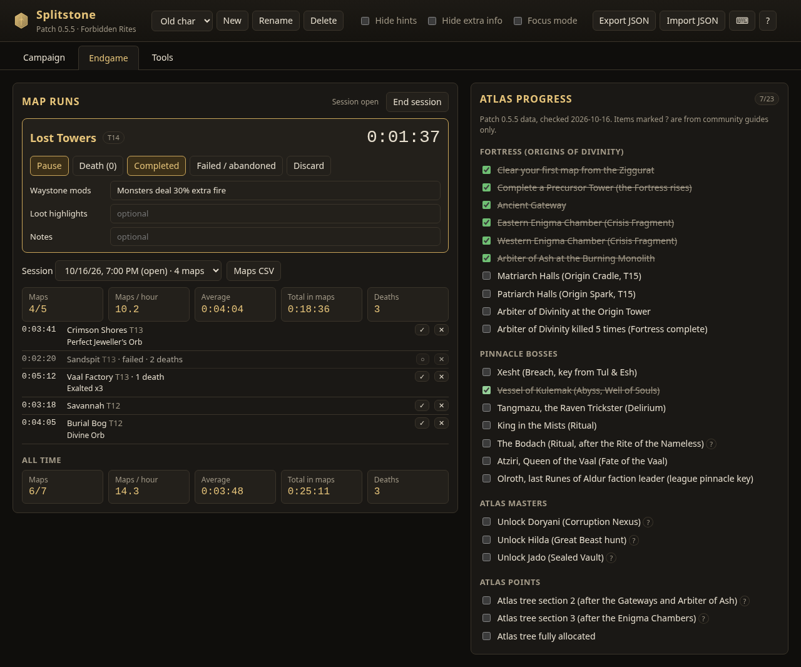
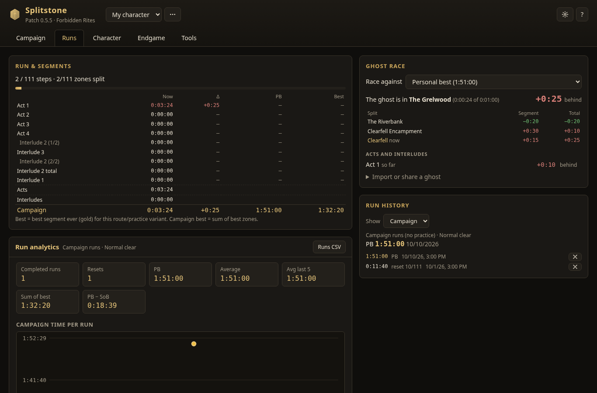
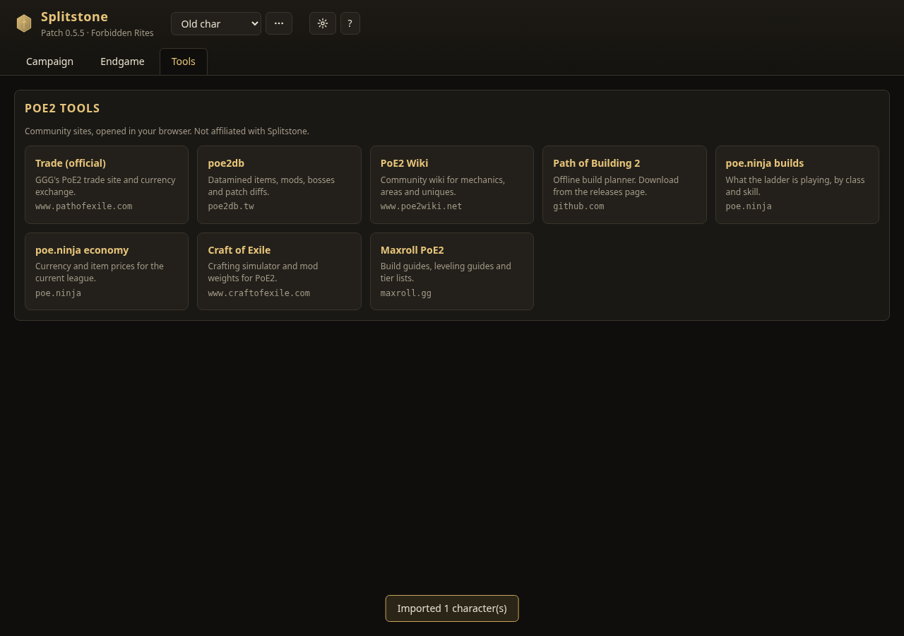
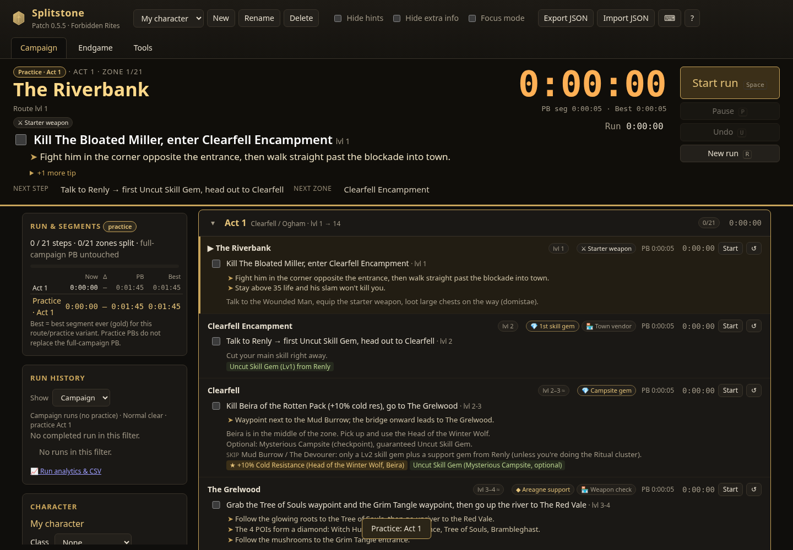

# Splitstone

I built Splitstone because I wanted one place to run the Path of Exile 2 campaign: a clear route, a real speedrun timer, and enough history to see where I lose time, without juggling a wiki tab, a stopwatch and a spreadsheet.

It's a campaign speedrun tracker and leveling guide for Acts 1–4 plus the Interludes (route data for patch 0.5.5). Use it in a browser, or install the desktop app for auto-split, global hotkeys and an in-game overlay.


## Download

**[Download Splitstone for Windows](https://github.com/noman-omen/poe2-splitstone/releases/latest)**

1. Under **Assets**, download **Splitstone-Setup-&lt;version&gt;.exe** (installer, recommended) or **Splitstone-Portable-&lt;version&gt;.exe**. Ignore the `.yml` and `.blockmap` files.
2. Run it (Windows 10/11 x64). Uninstall from Add/Remove Programs.
3. Builds are **not code-signed**, so SmartScreen may say "Windows protected your PC". Click **More info**, then **Run anyway**.
4. Splitstone finds Path of Exile 2's `Client.txt` automatically. If it can't, click **Client.txt…** and pick it (Steam folder → `Path of Exile 2` → `logs` → `Client.txt`). Only that file, or one in a known PoE2 folder, is read.
5. Play in **Windowed Fullscreen** so the overlay can sit on top.

Linux: download **Splitstone-&lt;version&gt;.AppImage**, make it executable and run it. Each release has a `SHA256SUMS` file to check your download against (`sha256sum -c SHA256SUMS --ignore-missing`).

Global hotkeys. Change them under Settings → Desktop → Global hotkeys in the desktop app; they need Ctrl+Alt or Ctrl+Shift, so bare keys are never taken from the game.

| Keys | Action |
| --- | --- |
| `Ctrl+Alt+S` | Split |
| `Ctrl+Alt+Z` | Undo |
| `Ctrl+Alt+P` | Pause / resume |
| `Ctrl+Alt+R` | New run (press twice within 3 s) |
| `Ctrl+Alt+H` | Show / hide hints in the app |
| `Ctrl+Alt+O` | Lock / unlock the overlay (unlocked = drag to move, corner to resize) |

Auto-update is on by default (Settings → Desktop to turn off). Full releases only get full releases; prerelease builds also see prereleases. A build that crashes on launch can't update itself, so reinstall from the link above.

---

## What it does

| | |
| --- | --- |
| **Run panel** | Zone, timers, Split, current objective with one hint, and the next step beside the checklist, readable from a second monitor. "+N more" shows the rest of the step. The ghost line opens a picker; −/+ on the level cue |
| **One act at a time** | Act and interlude tabs in route order; follows your run, C jumps back to the current zone |
| **Splits and timers** | Per-zone segments, act and interlude totals, pause, undo, auto-advance |
| **Routes** | Normal or speedrun route, required-steps-only, practice a single act or zone, custom shareable routes |
| **History and PBs** | Per-character runs, PBs, gold segments, live delta, trend charts, CSV export |
| **Ghost race** | Race your PB, best segments, any past run or a friend's ghost: ahead/behind per split, where the ghost is now, time gained or lost per act |
| **Auto-split** | Splits on zone changes from PoE2's `Client.txt` |
| **Cues** | All eight classes (Warrior, Ranger, Huntress, Witch, Sorceress, Mercenary, Monk, Druid) with their ascendancies, basic-class notes, level/XP warnings, gear and gem checkpoints. The desktop app can keep your level from your own level-ups in `Client.txt` |
| **Overlay** | Small panel at the top centre with the current step and the next step; move it, resize it, the text scales to fit |
| **Endgame** | Map runs with tier, mods, deaths and loot; session stats; atlas progress checklist |
| **Tools** | One-click links to trade, poe2db, the wiki, PoB2, poe.ninja and more |
| **PoB2 import, themes** | Paste a Path of Building 2 code (it sets the class if you haven't picked one); Ember, Slate, Crimson and Parchment themes, in the app and the overlay |

### In-game overlay

A browser tab can't sit on top of a fullscreen game, so the desktop app draws a small always-on-top panel with the current step and the next step, nothing else. Hints stay in the app. By default it's 400x80 at 1080p and below, a little larger on taller screens, at the top centre just below the boss health bar. It's click-through until you unlock it with `Ctrl+Alt+O` or the tray: then drag it anywhere and pull the bottom-right corner to resize it. The text scales to fill whatever size you pick and stays the same size from step to step; only an unusually long step gets smaller text, and it's cut short only at the smallest size (11px, the Next line included). Position and size are remembered. It uses the app's colour theme and changes with it. Opacity is a slider in Settings, from 65% to 100% (80% by default), and Settings → Desktop → Reset overlay position and size puts it back at the top centre at the default size. To play without it, turn off Settings → Desktop → Show in-game overlay (or untick it in the tray): the overlay window closes and its hotkeys do nothing until you turn it back on. Auto-split and the run hotkeys keep working.



### Character level from Client.txt

Put your character's in-game name on the Character tab and the desktop app sets the level whenever `Client.txt` logs "<name> (<class>) is now level N". Without a name, the run panel asks the first time it sees a level-up whether that's the character you're playing. Only the game's own level-up line is read: chat can't fake it, and other players' level-ups are ignored. Nothing is sent anywhere and nothing is written to the game. You can also nudge the level with −/+ on the run panel.

### Endgame

Log each map with its tier and waystone mods, then mark it completed or failed, count deaths and note any loot worth remembering. Sessions give you maps per hour, average map time and totals, and the atlas checklist tracks the Fortress, pinnacle bosses and atlas masters. Endgame data belongs to the selected character. In the desktop app, auto-detect can start and finish map runs from the zone changes it already reads for auto-split. Everything stays in local storage and goes into the JSON export; map timers from 1.0 are carried over.



The checklist lives in `data/endgame.js`. Items I couldn't confirm in patch notes or poe2db are marked with a ?.

### Ghost race

Turn it on under Settings → Ghost race. Pick what to race on the Runs tab, or click the ghost line under the run timer: your PB (default), your best segments, any saved run of this character, or a ghost a friend sent you. You get the delta for every split and in total, a line under the run timer saying which zone the ghost would be in right now, and how much you gained or lost in each act and interlude. To share a ghost, copy its code (`SSG1.…`) from the panel; to race someone, paste their code or load their Splitstone export file. Only zone times are taken from imports. The overlay stays current step and next step only.



### Tools

Links to the community sites I keep open while playing. The list is in `data/tools.js`.



### Run analytics and practice

Run history, analytics, CSV export and the full Run & Segments table are on the Runs tab; character details and PoB2 import are on the Character tab.

| Run analytics | Practice mode |
| --- | --- |
|  |  |

---

## Roadmap

My goal is to have Splitstone updated for PoE2 1.0 within the first week after it launches: route data, area IDs and zone names checked against the live game.

**Shipped in 1.0.0:** desktop app with auto-split and auto-update, minimal overlay, Ctrl+Alt global hotkeys, class notes, level/XP warnings, gear and gem checkpoints, custom shareable routes, practice mode.

**Shipped in 1.1.0:** endgame tracking (map runs, sessions, atlas progress, optional auto-detect) and a tools tab.

**Shipped in 1.2.0:** ghost race against your PB, best segments, a past run or a friend's shared ghost, plus overlay text size and accessibility fixes.

**Shipped in 1.3.0:** campaign page with one act at a time beside a run panel, Runs and Character tabs, a compact overlay with just the current and next step that you can move and resize, and the level read from Client.txt in the desktop app.

**Shipped in 1.3.1:** all eight classes with their ascendancies, the overlay in the app's theme, and a switch to turn the overlay off.

**Next:**

- Refresh the route and endgame data for PoE2 1.0

**Later:** ascendancy-specific route notes, pinnacle boss logs, league history.

See [CHANGELOG.md](CHANGELOG.md) for what changed in each release.

---

## Run from source

No build step. Serve the folder and open it:

```sh
python3 -m http.server 8765 --bind 127.0.0.1
# http://127.0.0.1:8765/
```

Desktop app: `cd desktop && npm install && npm start` (see [desktop/README.md](desktop/README.md)). Pushing a `v*` tag builds the Windows installer on GitHub Actions.

### Python helper (browser-only setups)

If you'd rather use the browser than the desktop app, `helper/splitstone_helper.py` tails `Client.txt` for auto-split and can show the same overlay:

```bat
py helper\splitstone_helper.py --overlay
py helper\splitstone_helper.py --overlay --log "D:\SteamLibrary\steamapps\common\Path of Exile 2\logs\Client.txt"
```

Then enable **Auto-split** in Splitstone on the same PC.

**Helper security (local only):** the helper binds `127.0.0.1` only. CORS reflects an Origin allowlist (`http://127.0.0.1`, `http://localhost`, `http://[::1]`, and `null` for `file://`). Optional `--token` / `$SPLITSTONE_TOKEN`: paste the same token under **Auto-split settings**. Fetch uses the `X-Splitstone-Token` header only; EventSource cannot set headers, so SSE uses `?token=` only. `GET /status` stays open and reports `auth: true|false`; with a token set it omits the log path. JSON exports never include the token. Helper URLs must not include `?query` or `#hash`. Import never auto-connects.

---

## Project layout

```
index.html            app shell
css/styles.css        themes and layout
js/                   storage, timers, run logic, charts, auto-split, PoB, UI
data/                 route, class notes, gear checkpoints, endgame milestones, tools
scripts/build_data.py regenerate data/campaign.js from route.json
desktop/              Electron app
helper/               Python helper (Client.txt to SSE, optional overlay)
tests/                Playwright and unit tests
screenshots/          README images
```

---

## Tests

```sh
pip install playwright && python3 -m playwright install chromium
python3 -m http.server 8765 --bind 127.0.0.1 &
python3 tests/smoke_test.py
python3 tests/layout_test.py
python3 tests/overlay_test.py
python3 tests/overlay_theme_test.py
python3 tests/classes_test.py
python3 tests/security_test.py
python3 tests/autosplit_test.py
python3 tests/endgame_test.py
python3 helper/test_helper.py
(cd desktop && npm test)       # also runs tests/*.test.js
```

Tests write screenshots to `test-output/`. Run with `SPLITSTONE_UPDATE_SHOTS=1` to refresh the images in `screenshots/`.

---

## Contributing

Issues and pull requests are welcome. For route or area-ID fixes, say which patch you checked against. Keep the web app static, with no required build step.

## License

MIT, see [LICENSE](LICENSE).

## Disclaimer

Fan-made and not affiliated with or endorsed by Grinding Gear Games. Path of Exile is a trademark of Grinding Gear Games. Route information comes from community sources and may be out of date.
