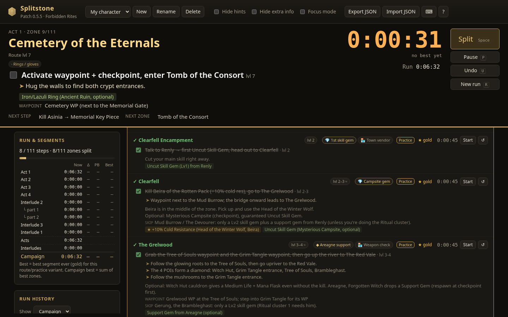
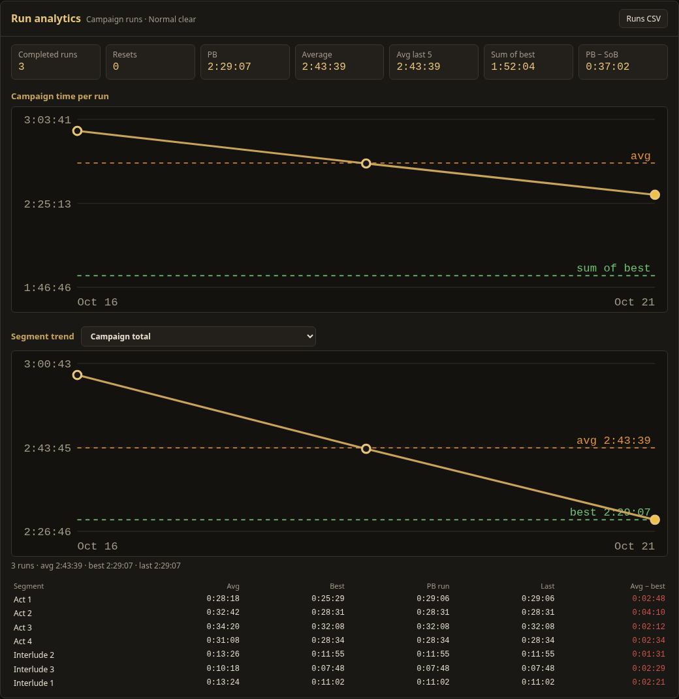
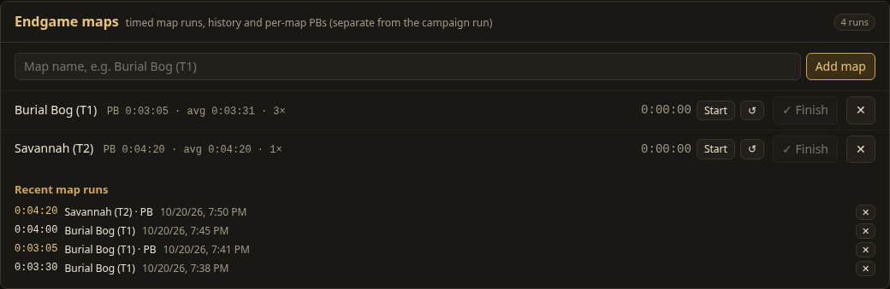
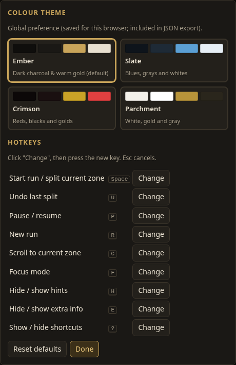
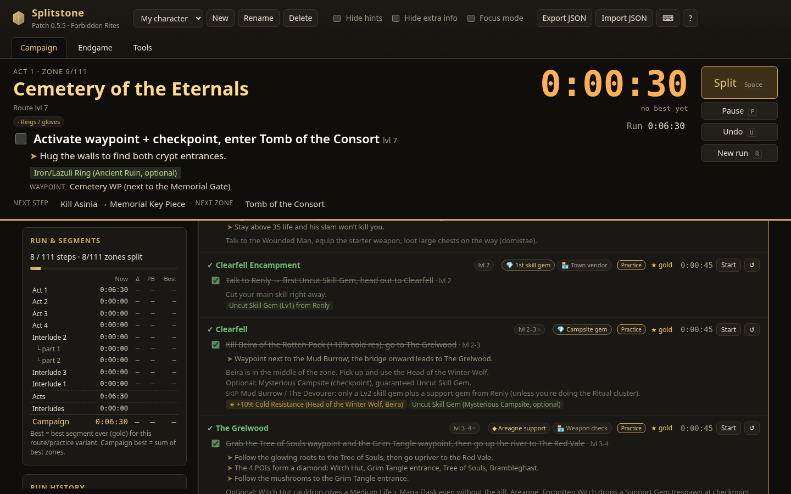
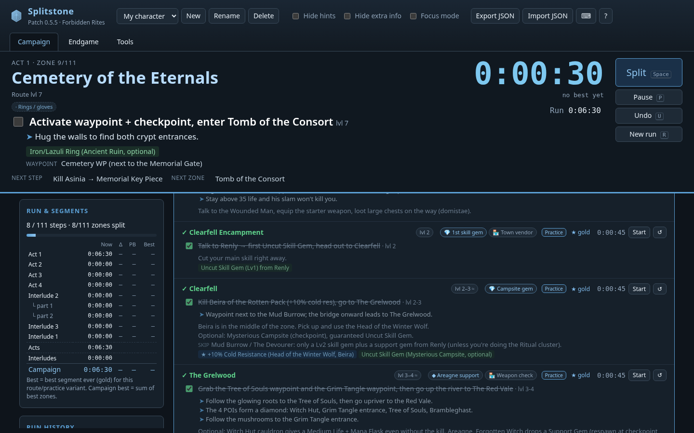
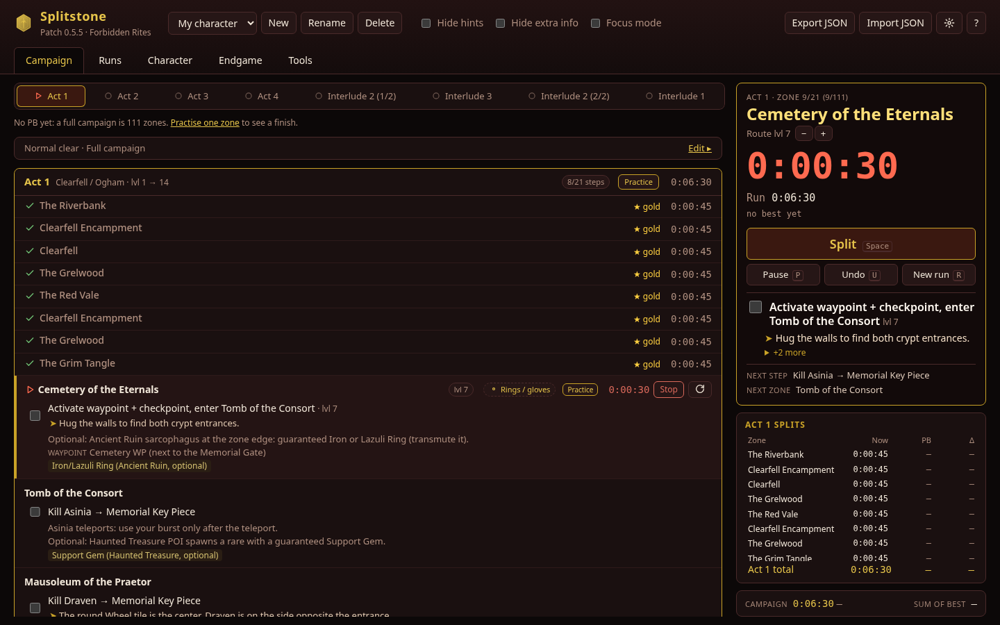
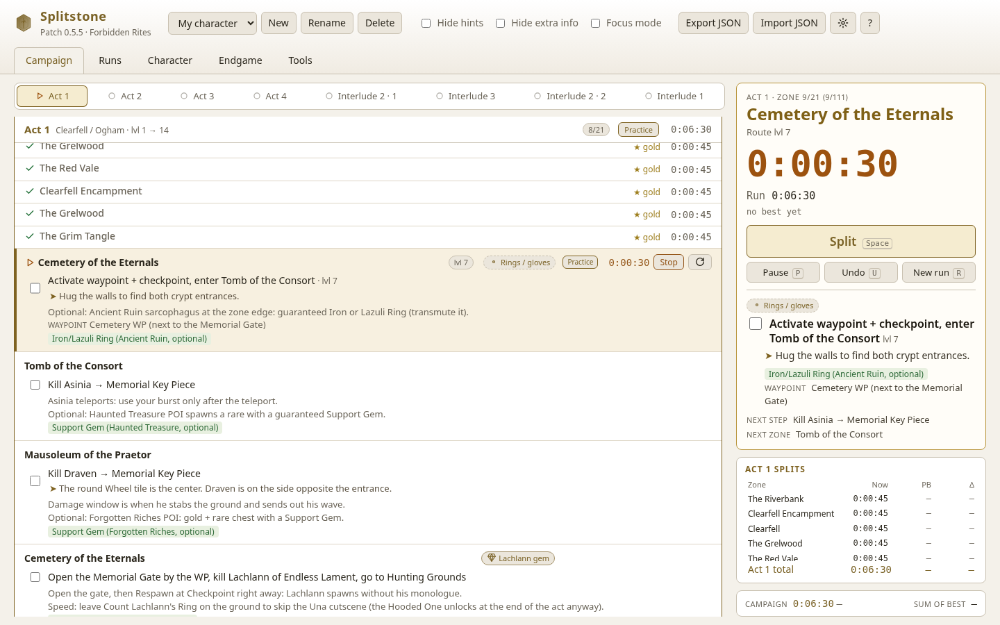
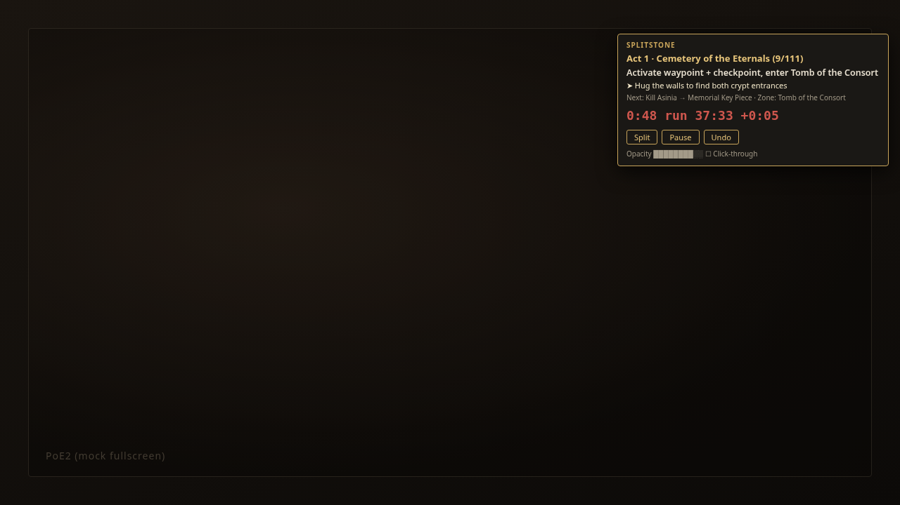

# Splitstone

I built **Splitstone** because I wanted one place to run the Path of Exile 2 campaign: a clear route, a real speedrun timer, and enough history to know where I am losing time — without juggling a wiki tab, a stopwatch, and a spreadsheet.

**Splitstone** is a static, offline-friendly web app: a PoE2 campaign **speedrun tracker and leveling guide** for Acts 1–4 plus the Interludes (currently patch **0.5.5 / Forbidden Rites**). Open it in a browser, pick a character, hit Space, and play.

My goal is to make Splitstone the one-stop-shop tool for the PoE2 campaign, and to grow it into endgame tracking after 1.0.



---

## What it does

| | |
| --- | --- |
| **Current step bar** | Big zone name, current objective, tips, next step/zone — readable from a second monitor |
| **Splits & timers** | Per-zone segments; act and interlude totals; pause, undo, auto-advance |
| **Route guide** | Normal clear or fast/speedrun route, optional “required steps only” |
| **History & PBs** | Per-character runs, personal bests, gold segments, live delta vs PB |
| **Auto-split** | Optional helper that tails PoE2 `Client.txt` and splits on zone changes |
| **PoB2 import** | Paste a Path of Building 2 code into the character panel |
| **Themes** | Ember (default), Slate, Crimson, Parchment |
| **In-game overlay** | Small top-right always-on-top panel from the Windows helper |

### Now bar (in-game glance)


### Run analytics, maps, hotkeys

| Run analytics | Endgame maps | Hotkeys |
| --- | --- | --- |
|  |  |  |

### Colour themes

| Ember (default) | Slate |
| --- | --- |
|  |  |
| **Crimson** | **Parchment** |
|  |  |

### In-game overlay (top-right corner)

A browser tab cannot sit on top of fullscreen PoE2. I ship a small always-on-top panel in the helper instead — current zone, step + tip, next, and timer — with opacity and click-through.



---

## Features

- **Campaign checklist** — 111 steps grouped by act / interlude → zone (patch 0.5.5 route data), with objectives, levels, hints, rewards, waypoints, and skips.
- **Speedrun splits** — Space starts and splits; ticking the last required step of a timed zone also advances. Undo, pause/resume, and new run are one key each.
- **Separate interludes** — Interlude 2 (parts 1 & 2), 3, and 1 each have their own timers; Interlude 2’s total is both parts combined.
- **Route variants** — *Normal clear* or *Fastest (speedrun)* from the original guide data; *Required steps only* hides optionals. PBs and bests are tracked per variant.
- **History & analytics** — Completed and abandoned runs, PB, gold segments, sum of best, SVG trend charts, per-act “avg − best,” CSV export.
- **Map history** — Timed map runs with per-map PB / average and CSV export (separate from the campaign run).
- **Characters** — Create, switch, rename, delete; one saved campaign per character.
- **Persistence** — `localStorage` (`splitstone:v1`; older `poe2-campaign-tracker:v1` saves migrate automatically). JSON export / import.
- **Auto-split from Client.txt** — Optional local helper (SSE) or Chrome/Edge File System Access. Hideouts, re-entries, and backtracking are ignored.
- **Rebindable hotkeys** — Settings panel with conflict detection; bindings export with the save.
- **PoB2 import** — Decode a build code in-browser (base64url + zlib → XML); bad codes fail gracefully.
- **Themes** — Ember, Slate, Crimson, Parchment (global preference, in settings and export).
- **In-game overlay** — Optional helper `--overlay` opens a compact top-right corner panel (zone, step + tip, next, timer) with opacity and click-through. The browser alone cannot draw over fullscreen games.
- **Focus mode & phone layout** — Second-monitor focus; compact sticky bar on small screens.

---

## Vision

I want Splitstone to be the tool I actually leave open for the whole league launch: campaign route, timer, and feedback in one window. Campaign is the foundation. After that I want endgame — maps, atlas-style progress, and the same split discipline applied outside the story.

---

## Roadmap

**Stated goal:** have Splitstone available and updated for **PoE2 1.0 by the end of the first week after the 1.0 release** (“1.0 release week” — I am not inventing a calendar date).

| Phase | Focus |
| --- | --- |
| **Current (0.5.x)** | Campaign tracker as it stands: acts, interludes, splits, auto-split helper, themes, in-game overlay |
| **Pre-1.0 hardening** | Polish, test coverage, helper robustness, docs, and anything that would break under a full data refresh |
| **1.0 launch week** | Refresh route data for 1.0 acts and zones, area IDs, and verification against the live game |
| **Post-1.0 endgame** | Atlas / map tracking and the endgame items below |

### Priority #1 — Always-on-top in-game overlay

A browser tab cannot draw over a fullscreen game. I am shipping a **small top-right corner panel** in the Windows helper: always-on-top, low distraction, current zone + current step + tip + next + timer, with opacity and click-through toggles. The browser stays the source of truth and pushes state to the helper over localhost.

### Campaign intelligence

- **Class-aware notes** for the basic classes first (Warrior, Sorceress, Ranger, Monk, Mercenary, Witch) — not subclass-specific yet: class-flavoured campaign steps and recommended campaign reward choices by class
- Level / XP warnings per zone
- Gear and gem checkpoints along the route
- Build-specific route notes later (Monk / Oracle ascendancy layers)
- Custom shareable routes
- Ghost / race mode (run against a ghost PB)
- Single-act practice mode

### Endgame (post-1.0)

- Atlas progress tracking
- Profit-per-hour style session stats
- Pinnacle boss logs
- League / atlas checklists
- Season / league history
- Leaderboards / shared PBs

### Ecosystem

Buttons or tabs that deep-link or embed popular PoE2 tools (currency / market sites, crafting helpers, and similar). I will research and pick concrete URLs before wiring them — listed here as a goal, not as invented links.

---

## Quick start

No build step. Either open `index.html` in a browser, or serve the folder:

```sh
python3 -m http.server 8765 --bind 127.0.0.1
# → http://127.0.0.1:8765/
```

### Auto-split + in-game overlay on Windows

A normal browser window **cannot** draw over fullscreen PoE2. Use the helper for auto-split and the overlay.

1. Install Python 3 from python.org (tick *Add to PATH*), or `winget install Python.Python.3.12`.
2. Copy the `helper` folder to the gaming PC.
3. Double-click `run_helper.bat` (starts with `--overlay`), or:

   ```bat
   py helper\splitstone_helper.py --overlay
   py helper\splitstone_helper.py --overlay --log "D:\SteamLibrary\steamapps\common\Path of Exile 2\logs\Client.txt"
   ```

   Defaults it looks for:

   - Steam: `C:\Program Files (x86)\Steam\steamapps\common\Path of Exile 2\logs\Client.txt`
   - Standalone: `C:\Program Files (x86)\Grinding Gear Games\Path of Exile 2\logs\Client.txt`

4. Open Splitstone on the same PC and enable **Auto-split** (that connection also pushes the current step to the overlay).
5. The panel sits in the **top-right**. Drag the SPLITSTONE title to move it. Use the opacity slider and **Click-through** (Windows) so mouse clicks pass through to the game.
6. Optional global hotkeys (work while the game has focus): `py -m pip install pynput`, then  
   `py helper\splitstone_helper.py --overlay --hotkeys` (F1 split, F2 undo, F3 pause).

Overlay buttons publish the same hotkey actions over the helper’s event stream, so Split / Pause / Undo work without focusing the browser.

---

## Project layout

```
index.html            app shell
css/styles.css        themes + layout
js/                   storage, timers, run logic, charts, auto-split, PoB, UI
data/campaign.js      generated route data
scripts/build_data.py regenerate data from route.json
helper/               splitstone_helper.py (Client.txt → SSE)
assets/               logo.svg, favicon.svg
tests/                Playwright + helper unit tests
screenshots/          README images
```

Update route data from the upstream guide JSON:

```sh
python3 scripts/build_data.py /path/to/route.json
```

---

## Tests

```sh
pip install playwright && python3 -m playwright install chromium
python3 -m http.server 8765 --bind 127.0.0.1 &
python3 tests/smoke_test.py
python3 tests/autosplit_test.py
python3 helper/test_helper.py
python3 helper/test_overlay_state.py
python3 tests/overlay_shot.py      # regenerate screenshots/overlay-corner.png
```

---

## Contributing

Issues and pull requests are welcome. For route or area-ID fixes, say which patch you checked against. Keep the app static (no required build step) unless there is a strong reason not to.

---

## License

MIT — see [LICENSE](LICENSE). Copyright © 2026 Splitstone contributors.

---

## Disclaimer

This is a fan-made project. It is **not affiliated with or endorsed by Grinding Gear Games**. Path of Exile is a trademark of Grinding Gear Games. Route information is compiled from community sources, may be outdated, and is provided as-is. Use at your own risk.
